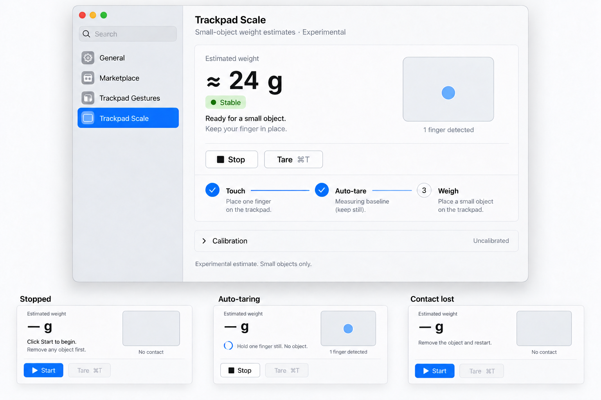
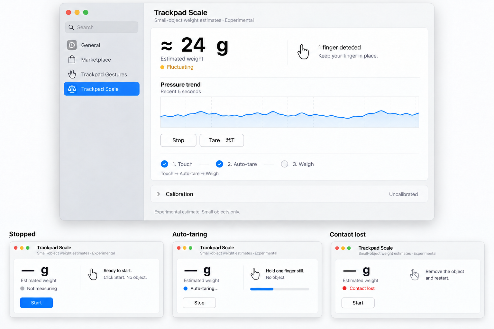

# Trackpad Scale UI concepts

These mockups explore the plugin settings interface before implementation. They were generated with the built-in imagegen tool and refined to correct state instructions. All readings, pressure curves, and contact markers are illustrative. No UI code was changed for this design exploration.

## Direction A: Focused scale



Prioritize the approximate whole-gram reading, a simple finger-contact indicator, and short instructions. Keep calibration in a disclosure section. Show stopped, automatic-tare, and lost-contact states without changing the main layout.

**Recommended starting point.** This makes the main workflow clearer while keeping the content compact. The trackpad marker can represent single-contact presence without retaining or presenting raw touch coordinates.

## Direction B: Scale with feedback



Keep the reading prominent and add a secondary pressure trend to explain fluctuations. The chart is a proposed feature; the current implementation does not expose a five-second chart history. Any implementation should use a bounded in-memory display buffer without logging or saving raw samples.

## Interaction requirements

- Start with no object on the trackpad. Capture the initial tare automatically after about one second of continuous valid single-finger contact.
- Show automatic-tare progress and a clear ready state. Readiness is separate from the pressure-stability indicator.
- Preserve the baseline while pressure changes during weighing. Do not repeatedly auto-zero it.
- Clear the estimate immediately after lost, replaced, multiple, or invalid contact. Explain that the object must be removed before restarting or manually taring.
- Keep ⌘T for a manual baseline reset. A visible restart control after contact loss should explicitly stop and start the current session.
- Preserve the host sidebar, page header, grouped form styling, semantic fonts, disabled controls, and accessibility. Localize final app copy in all supported languages.
- The mockup colors, icons, and wording are design proposals. Keep the empirical estimate and calibration limitations in the implemented interface.

## Generation prompts

Mode: built-in imagegen. Each concept was generated separately and then edited with its own generated image as the sole edit target.

### Direction A: native button icons (v2)

The focused concept uses `play.fill` for Start and `stop.fill` for Stop, retaining the text labels. The original version is preserved as `focused-scale-v1.png`.

```text
Use case: ui-mockup
Input image 1: edit target, the approved "Focused scale" MacTools Trackpad Scale concept sheet.
Primary request: Add small native macOS SF Symbol icons to the Start and Stop buttons, retaining their text.
Changes only:
- Every "Start" button on the sheet gets a small filled right-pointing play triangle (SF Symbol play.fill) immediately before the word "Start".
- Every "Stop" button on the sheet gets a small filled square (SF Symbol stop.fill) immediately before the word "Stop".
- Keep the icons aligned to the text baseline, with restrained native spacing and the same visual size as the button text. The icon on a blue Start button is white. The icon on a neutral bordered Stop button is dark.
Invariants: preserve the canvas dimensions, entire app shell and sidebar, main layout, weight display, contact graphic, all instructions and state labels, colors, calibration disclosure, step guide, card borders and spacing. Keep "Tare ⌘T" exactly as shown. Preserve text labels and disabled-control appearances. No emoji, colored pictograms, extra icons on other controls, additional text, or redesign.
```

### Direction A: initial prompt

```text
Use case: ui-mockup
Asset type: high-fidelity native macOS settings UI concept for the MacTools Trackpad Scale plugin, direction A, "Focused scale".
Primary request: Create a polished, implementable native macOS redesign of an experimental trackpad weighing plugin, emphasizing a large estimated weight, automatic tare, and keeping a single finger in place. This is a design mockup, not a screenshot of real measurements.
Composition: landscape design sheet, one large front-facing macOS Settings window occupying most of the sheet, plus three small labeled state previews along the bottom. No laptop mockup, no perspective tilt. Crisp readable UI.
Main window: native traffic lights and restrained toolbar; standard translucent pale-gray sidebar showing "General", "Marketplace", "Trackpad Gestures", "Trackpad Scale" with Trackpad Scale selected. The content header appears once: "Trackpad Scale", with subtitle "Small-object weight estimates · Experimental". The host header sits outside the grouped form.
Content: elegant native grouped Form, system neutral backgrounds, generous consistent spacing. A single measurement section with a dominant monospaced "≈ 24 g" readout, small "Estimated weight" label and a restrained green "Stable" badge. Below it, a subtle native trackpad outline with one blue touch marker and the compact line "1 finger detected". Show "Ready for a small object" and "Keep your finger in place." Blue accent is used sparingly. Two small native bordered buttons "Stop" and "Tare  ⌘T". Show a compact three-step horizontal setup guide "Touch" → "Auto-tare" → "Weigh", with the first two steps completed. A collapsed native disclosure row below, "Calibration", secondary value "Uncalibrated", followed by a small muted footer "Experimental estimate. Small objects only."
State previews: show the same readout area and stable layout in three compact miniature previews titled "Stopped", "Auto-taring", "Contact lost". Stopped shows "— g" and "Start". Auto-taring shows "— g", a small progress indicator, and "Hold one finger still. No object." Contact lost shows "— g" and "Remove the object and restart." Do not show a mass while there is no contact.
Style: Apple-native SwiftUI/AppKit appearance, light mode, SF-style semantic typography, conventional SF Symbols, subtle separators, native controls, realistic margins, accessible contrast.
Constraints: use verbatim English text provided above. Maintain a practical macOS settings layout; do not duplicate page titles or nest decorative cards inside the measurement section. Whole-gram approximate readings only; no fake accuracy percentages or confidence scores. No charts in this direction. No new hardware support or calibration claims. No photoreal fingers, 3D hardware, neon, gradients, oversized web-app toggles, marketing slogans or watermarks. Keep design sheet labels outside the app.
```

### Direction A: refinement prompt

```text
Use case: ui-mockup
Input image 1: edit target, existing "Focused scale" native macOS design sheet.
Primary request: Correct only the instruction and state copy in this UI mockup. Preserve its layout, dimensions, typography, readout, color palette, app chrome, contact illustration, calibration disclosure, and all other visual details.
Required corrections:
1. In the large window's third "Weigh" step replace the instruction "Place a small object on your finger." with the exact instruction "Place a small object on the trackpad." Do not instruct users to put an object on their finger.
2. In the "Stopped" miniature replace the incorrect ready message and finger instruction with the exact text "Click Start to begin." and "Remove any object first." Replace "1 finger detected" under the empty trackpad with "No contact".
3. In the "Contact lost" miniature replace "1 finger detected" under the empty trackpad with "No contact". Preserve "Remove the object and restart."
Keep the auto-taring miniature's detected-contact state unchanged. Do not add extra features, labels or decorative elements.
```

### Direction B: initial prompt

```text
Use case: ui-mockup
Asset type: high-fidelity native macOS settings UI concept for the MacTools Trackpad Scale plugin, direction B, "Scale with feedback".
Primary request: Design a polished, implementable native macOS experimental trackpad scale with a large estimated weight and a small pressure trend, so a user can understand finger-pressure fluctuations while automatic tare makes the main workflow effortless. Concept data is illustrative.
Composition: landscape design sheet with one large front-facing native Settings window, and three small labeled state previews along the bottom. The overall hierarchy and app chrome should be restrained, practical, and comparable to Apple's macOS settings. No perspective or device mockup.
App shell: traffic lights, native toolbar, pale translucent gray sidebar with "General", "Marketplace", "Trackpad Gestures", and selected "Trackpad Scale". A single host content header "Trackpad Scale" and subtitle "Small-object weight estimates · Experimental".
Main measurement section: a large monospaced "≈ 24 g", "Estimated weight", subtle amber "Fluctuating" status, "1 finger detected", and "Keep your finger in place." Under the reading place a shallow native blue line chart labeled "Pressure trend" with sublabel "Recent 5 seconds", gentle fluctuation and sparse neutral gridlines. It is a relative pressure visualization, not an accuracy or mass calibration chart: no gram axis, no confidence percentages. Below the chart show native small bordered "Stop" and "Tare  ⌘T" buttons. Make automatic tare apparent with concise setup guidance: "Touch → Auto-tare → Weigh". The first two steps are completed.
Calibration: a collapsed native disclosure row "Calibration" with summary "Uncalibrated". A muted footer says "Experimental estimate. Small objects only."
State previews: "Stopped" with "— g" and "Start"; "Auto-taring" with "— g", a progress indicator, and "Hold one finger still. No object."; "Contact lost" with "— g" and "Remove the object and restart." Keep layouts consistent and never display a mass in a missing-contact state.
Style: light mode, system grays, restrained blue accent, SF-style typography and SF Symbols, readable chart labels, native grouped Form owning section backgrounds, no extra nested shadows or decorative cards. The plot is secondary to the weight and contact state.
Constraints: render the provided English text accurately. No extra features, no fake precision, no claim of one-gram accuracy, no photoreal fingers, 3D objects, neon gradients, web-dashboard chrome, slogans or watermarks. Show prototype labels outside the app window.
```

### Direction B: refinement prompt

```text
Use case: ui-mockup
Input image 1: edit target, existing "Scale with feedback" native macOS design sheet.
Primary request: Correct only the stopped and automatic-tare state control copy. Preserve the layout, dimensions, typography, pressure chart, color palette, app chrome, reading, calibration disclosure, and other visuals.
Required corrections:
1. In the "Stopped" miniature retain "Ready to start." but replace "Touch with one finger to begin." with the exact text "Click Start. No object."
2. In the "Auto-taring" miniature change the button "Cancel" to "Stop", matching the ongoing-session control in the main view.
Do not change any other text or add any elements.
```
